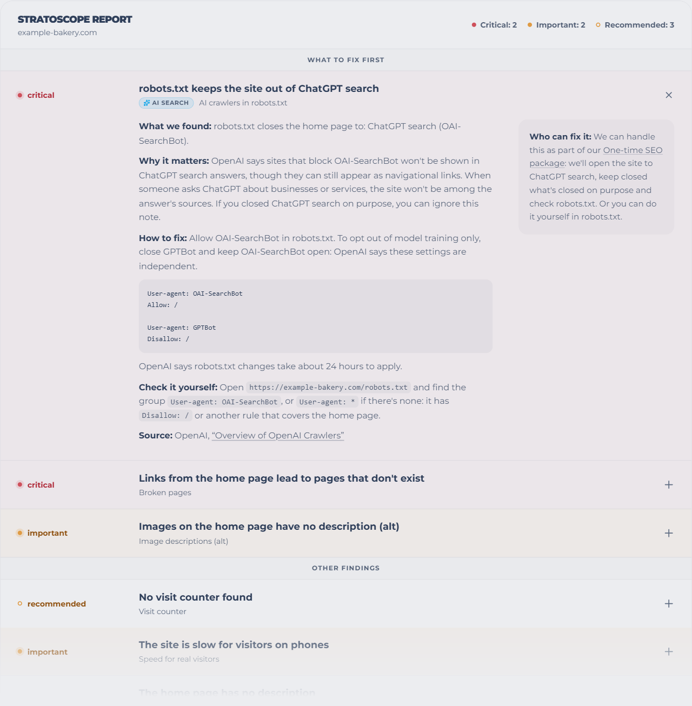
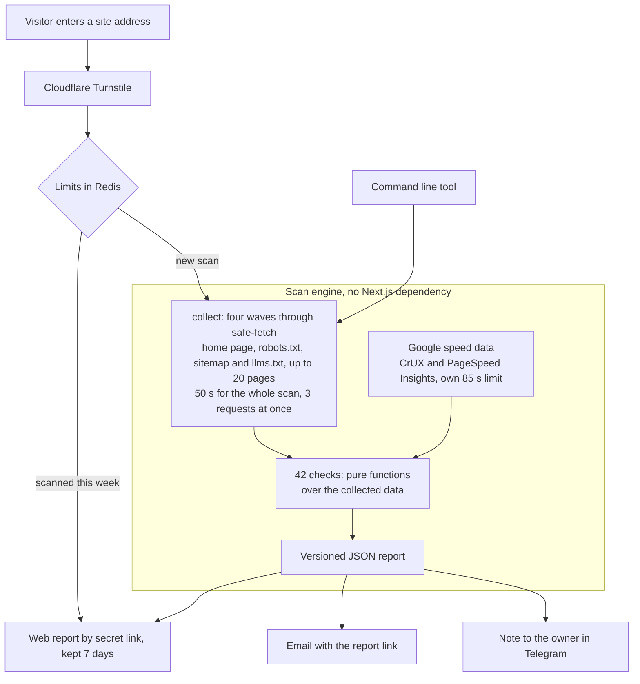

# Stratoscope

A free SEO check for Google and AI search. Built and running on [stratosly.com/scan](https://stratosly.com/scan) (Russian version: [stratosly.com/ru/scan](https://stratosly.com/ru/scan)).

**Source is private. This repository documents the architecture and includes selected code excerpts.**

## What it does

A visitor enters a site address. In about 30 to 90 seconds Stratoscope opens the site the way a search crawler does: the home page over HTTPS and HTTP, its www mirror, robots.txt, the sitemap, llms.txt and up to 20 pages. In parallel it asks Google for the home page's speed: real visitors over 28 days (Chrome UX Report) and a lab test (PageSpeed Insights).

The report comes in three parts: what to fix first, what passed, and what could not be checked and why. Every finding carries the facts it rests on and a way to see the problem yourself, such as "open view-source: and search for `<a href`", so nothing has to be taken on trust.

The same engine runs as a command line tool for client work, without the web layer.

The same report on a phone: [docs/report-phone.png](docs/report-phone.png).

## What it checks

42 checks in five groups, in report order:

| Group | Checks |
|---|---|
| Technical (16) | HTTPS, home page status, www mirror, copies of the home page at /index.html and /index.php, mixed content, robots.txt, sitemap, whether Google may index the home page, broken pages, a made-up address answering 404, noindex and canonical on inner pages, hreflang, viewport, security headers, an analytics counter |
| Speed (5) | Core Web Vitals of real visitors, render-blocking resources, the main image, layout shift, images worth compressing |
| Content (12) | Title and description of the home page and of inner pages, duplicates across pages, H1, whether the page names the service and the city the visitor gave, image alt text, broken images, image file names, Open Graph, favicon, trust pages such as About and Contacts |
| Structured data (4) | JSON-LD validity, Organization, LocalBusiness, WebSite |
| AI search (5) | Which of 16 AI crawlers robots.txt lets in, whether the home page has text without JavaScript, snippet rules that keep text out of Google snippets and AI Overviews, Copilot rules (noarchive, nocache), llms.txt |

The AI search group answers one question: can AI assistants read the site at all. ChatGPT, Claude and Perplexity crawlers do not run JavaScript, so a site drawn in the browser looks empty to them even when it ranks in Google.

## What it does not check, by design

The check sees the site from outside, without access to the owner's accounts. It says so in every report:

- what AI assistants say about the business and whom they recommend instead;
- rankings, search queries and their volume;
- how many pages Google has indexed and why the rest did not make it (only Search Console knows);
- pages no link leads to, which needs a crawl of the whole site;
- Google Maps and social profiles;
- protection services that turn AI crawlers away even when robots.txt lets them in;
- backlinks and spelling.

## How it works

1. **Collect.** `collect` is the only step that uses the network. It works in four waves, each depending on the previous one: the home page decides which origin to read robots.txt from, robots.txt decides which sitemap to read and which pages the scanner may open.
2. **Check.** Every check is a pure function of the collected data: it never touches the network. That is what makes the checks testable on saved pages and safe to run in any order.
3. **Report.** The report is a versioned JSON document. The web page, the command line output and the owner's note are built from it; the email carries a link to the web page.

## Engineering decisions

- **No language model in the pipeline.** Every verdict is computed by code. A page cannot talk its way into a better report, because nothing reads its text as instructions.
- **One door to the outside world.** All outgoing requests go through `safe-fetch`, built on `node:https` and `node:net` without packages. Only public addresses and ports 80 and 443. The IP is checked at connect time and again on every redirect, so a DNS answer that changes between the check and the connection does not get through. Sizes and times are capped. A request that carries an API key never follows a redirect to another site.
- **Hostile pages stay data.** HTML is parsed with parse5, JSON-LD with `JSON.parse`, and script files are searched as text. Nothing from a scanned site is executed or stored. Reading has its own budget: 2 seconds a page, 6 seconds for all pages of one scan.
- **robots.txt by RFC 9309, without regular expressions.** The matcher tracks reachable positions instead of backtracking, so a hostile pattern cannot keep the server busy for minutes.
- **Little personal data.** A visitor's IP is stored only as an HMAC with a server secret, enough to count scans and useless to anyone who reads the store. A report link holds 192 random bits, and the store keeps only its hash. Texts of scanned pages are never stored.
- **Abuse limits.** Cloudflare Turnstile, three scans a day per address and per email, one scan of a site a week (a second request shows the same report).
- **Thin integrations.** Upstash Redis, Resend, Telegram and Turnstile are called over HTTP with `fetch`, without their SDKs. Each takes the `fetch` function as a parameter, so tests pass a fake one.

## Tests

- 83 unit test files with `node:test`, mostly checks run against saved pages and edge cases: hostile robots.txt patterns, redirects into private networks, pages that answer every address with 200.
- Playwright end to end tests for the visitor's path from the form to the report.

## Stack

TypeScript, Node.js (`node:https`, `node:net`, `node:dns`, `node:crypto`), Next.js 16 (App Router), React 19, parse5, Upstash Redis over REST, Cloudflare Turnstile, Resend, Google PageSpeed Insights and Chrome UX Report APIs, `node:test`, Playwright. Hosted on Vercel.

## Code excerpts

| File | What it shows |
|---|---|
| [snippets/ip-policy.ts](snippets/ip-policy.ts) | Which addresses count as public, with `node:net` BlockList |
| [snippets/safe-fetch.ts](snippets/safe-fetch.ts) | The outgoing client: address check at connect time, redirects, limits, retries |
| [snippets/robots.ts](snippets/robots.ts) | robots.txt parser and matcher by RFC 9309 |
| [snippets/ai-access.ts](snippets/ai-access.ts) | How robots.txt treats each AI crawler, and the llms.txt fact |
| [snippets/collect.ts](snippets/collect.ts) | The four collection waves under one deadline and a concurrency limit |
| [snippets/text-without-js.ts](snippets/text-without-js.ts) | One check end to end: what AI crawlers see without JavaScript |
| [snippets/access.ts](snippets/access.ts) | Hashed visitor addresses, secret report links, daily limits |

Excerpts are copied from the private source with internal references removed. They import modules that are not included, so they are for reading, not for running.

## Author

Anthony Fox, [stratosly.com](https://stratosly.com).
