# Stratoscope

A free check of whether Google and AI assistants can find and read a website. It puts the most serious problems first and shows how to verify each one. Live since October 2026 on [stratosly.com/scan](https://stratosly.com/scan) (Russian version: [stratosly.com/ru/scan](https://stratosly.com/ru/scan)).

**Source is private. This repository documents the architecture and includes selected code excerpts.**

The same report on a phone: [docs/report-phone.png](docs/report-phone.png).

## Why it exists

Stratoscope is the lead funnel of Stratosly, my web and SEO studio. A site owner gets a free report that puts the most serious problems first. The report opens once they leave an email, the link arrives there, and I get a note in Telegram. The check has to be worth running on its own, so every finding can be verified without trusting me.

## How I built it

I led the development end to end and used AI coding agents as tools: Claude Code, OpenAI Codex and Google Gemini. The commits went through Claude Code, so they carry its co-author line.

- **Decisions:** the product and its place in my studio's lead funnel, the architecture, what the scan checks and how serious each finding is, every report text in English and Russian, the limits and what is stored, the launch.
- **Process:** each part planned before code and covered by tests, nothing merged without my approval.

## In numbers

- Scan engine: 143 TypeScript files, about 14,000 lines, with 83 test files of about 7,500 lines.
- Web layer (the form, the progress screen, the report pages, the API routes): 58 files, about 5,200 lines.
- About 150 commits over seven weeks from 28 September 2026; live since 12 October.

## What it does

A visitor enters a site address and, while the scan runs, an email. In up to 90 seconds Stratoscope opens the site the way a search crawler does: the home page over HTTPS and HTTP, its www mirror, robots.txt, the sitemap, llms.txt and up to 20 pages. In parallel it asks Google for the home page's speed: real visitors on phones over 28 days (Chrome UX Report) and a lab test (PageSpeed Insights).

The report comes in four parts: what to fix first, other findings, what passed, and what could not be checked and why. Every finding carries the facts it rests on and a way to see the problem yourself, such as "open view-source: and search for `<a href`", so nothing has to be taken on trust.

The same engine also runs as a command line tool, without the web layer.

## What it checks

42 checks in five groups, in report order:

| Group | Checks |
|---|---|
| Technical (16) | HTTPS, home page status, www mirror, copies of the home page at /index.html and /index.php, mixed content, robots.txt, sitemap, whether Google may index the home page, broken pages, a made-up address answering 404, noindex and canonical on inner pages, hreflang, viewport, security headers, an analytics tag |
| Speed (5) | Core Web Vitals of real visitors, render-blocking resources, the main image, layout shift, images worth compressing |
| Content (12) | Title and description of the home page and of inner pages, duplicates across pages, H1, whether the page names the service and the city the visitor gave, image alt text, broken images, image file names, Open Graph, favicon, trust pages such as About and Contacts |
| Structured data (4) | JSON-LD validity, Organization, LocalBusiness, WebSite |
| AI search (5) | How robots.txt treats 16 AI crawlers and robots.txt tokens, whether the home page has text without JavaScript, snippet rules that keep text out of Google snippets and AI Overviews, Copilot rules (noarchive, nocache), llms.txt |

The AI search group answers one question: can AI assistants read the site at all? ChatGPT, Claude and Perplexity crawlers do not run JavaScript (Vercel's measurement, December 2024), so a site rendered only in the browser looks empty to them even when it ranks in Google.

## What it does not check, by design

The scan sees the site from outside, without access to the site owner's accounts. Each report has a section on what that leaves out:

- what AI assistants say about the business and whom they recommend instead (planned as a separate paid measurement, not built yet);
- rankings and the searches that show the site;
- how many pages Google has indexed and why the rest did not make it (only Search Console knows);
- pages that no link leads to (finding them takes a crawl of the whole site);
- Google Maps and social profiles;
- protection services that turn AI crawlers away even when robots.txt lets them in.

Backlinks and spelling are not checked either.

## How it works

```mermaid
flowchart TD
  V[Visitor enters a site address] --> T[Cloudflare Turnstile]
  T --> L{Limits in Redis}
  L -->|scanned this week| W
  L -->|new scan| C
  subgraph Engine [Scan engine, no Next.js dependency]
    C[collect: four waves through safe-fetch<br/>home page, robots.txt, sitemap and llms.txt, up to 20 pages<br/>50 s for all requests to the site, 3 at once]
    G[Google speed data<br/>CrUX and PageSpeed Insights, own 85 s limit]
    K[42 checks: pure functions<br/>over the collected data]
    C --> K
    G --> K
    K --> P[Versioned JSON report]
  end
  P --> W[Web report by secret link, kept 7 days]
  V -.->|email, while the scan runs| M[Visitor's email]
  M --> E[Email with the report link]
  M --> N[Lead note to me in Telegram]
  P --> E
  P --> N
  CLI[Command line tool] --> C
```

1. **Collect.** `collect` is the only step that uses the network. It works in four waves, each depending on the previous one: the home page decides which origin to read robots.txt from, robots.txt decides which sitemap to read and which pages the scanner may open.
2. **Check.** Every check is a pure function of the collected data: it never touches the network. That is what makes the checks testable without a network, on HTML built in the tests, and safe to run in any order.
3. **Report.** The report is a versioned JSON document. The web page, the command line output and my Telegram note are built from it; the email carries a link to the web page.

## Engineering decisions

- **No language model in the pipeline.** Every verdict is computed by code. A page cannot talk its way into a better report, because nothing reads its text as instructions.
- **One door to scanned sites.** Every request to a scanned site and to Google's APIs goes through `safe-fetch`, built on `node:https` and `node:net` without packages. Only public addresses and ports 80 and 443. The IP is checked at connect time and again on every redirect, so a DNS answer that changes between the check and the connection does not get through. Sizes and times are capped. A request that carries an API key never follows a redirect to another site.
- **Hostile pages stay data.** HTML is parsed with parse5, JSON-LD with `JSON.parse`, and script files are searched as text. Nothing from a scanned site is executed, and page bodies are never stored: a report keeps short facts about the home page (its title, description and up to five H1 headings, each cut to 300 characters) and what its findings quote. Reading has its own budget: 2 seconds a page, 6 seconds for all pages of one scan.
- **robots.txt by RFC 9309.** The matcher cuts each pattern at `*` and finds the pieces left to right in one pass instead of using a regular expression, so even 500 KiB of stars takes milliseconds per address. A review by a separate AI agent found that the earlier matcher slowed down to seconds per address on such a file; the fix and its test are in the excerpts.
- **Little personal data.** The email is kept because the report goes to it: for a week, or until the person unsubscribes if they agreed to further letters. A visitor's IP is stored only as an HMAC with a server secret, enough to count scans and useless to anyone who reads the store. A report link holds 192 random bits, and the store keeps only its hash.
- **Abuse limits.** Cloudflare Turnstile, three scans a day per IP address, three report emails a day per email address, one scan of a site a week (a second request shows the same report).
- **Thin integrations.** Upstash Redis, Resend, Telegram and Turnstile are called over HTTP with `fetch`, without their SDKs. Each takes the `fetch` function as a parameter, so tests pass a fake one.

## Tests

- 83 unit test files, 579 tests with `node:test`: every check against HTML built in the tests and fake responses, plus edge cases: hostile robots.txt patterns, redirects into private networks, pages that answer every address with 200.
- Two of them are next to their excerpts: [snippets/robots.test.ts](snippets/robots.test.ts) (Google's own examples and hostile patterns) and [snippets/ip-policy.test.ts](snippets/ip-policy.test.ts) (private, reserved and disguised addresses).
- Playwright end-to-end tests for the visitor's path from the form to the report.

## Stack

TypeScript, Node.js (`node:https`, `node:net`, `node:dns`, `node:crypto`), Next.js 16 (App Router), React 19, parse5, Upstash Redis over REST, Cloudflare Turnstile, Resend, Google PageSpeed Insights and Chrome UX Report APIs, `node:test`, Playwright. Hosted on Vercel.

## Code excerpts

| File | What it shows |
|---|---|
| [snippets/ip-policy.ts](snippets/ip-policy.ts) | Which addresses count as public, with `node:net` BlockList |
| [snippets/ip-policy.test.ts](snippets/ip-policy.test.ts) | Its tests: public, private, reserved and disguised addresses |
| [snippets/safe-fetch.ts](snippets/safe-fetch.ts) | The outgoing client: address check at connect time, redirects, limits, retries |
| [snippets/robots.ts](snippets/robots.ts) | robots.txt parser and matcher by RFC 9309 |
| [snippets/robots.test.ts](snippets/robots.test.ts) | Its tests: Google's examples, groups, encoding, hostile patterns |
| [snippets/ai-access.ts](snippets/ai-access.ts) | How robots.txt treats each AI crawler, and the llms.txt fact |
| [snippets/collect.ts](snippets/collect.ts) | The four collection waves under one deadline and a concurrency limit |
| [snippets/text-without-js.ts](snippets/text-without-js.ts) | One check end to end: what AI crawlers see without JavaScript |
| [snippets/access.ts](snippets/access.ts) | Hashed visitor addresses, secret report links, daily limits |

Excerpts are copied from the private source with internal references removed. Most import modules that are not included, so they are for reading. The robots.txt and address excerpts are full files, and their tests run as they are, with nothing to install: `node --test "snippets/*.test.ts"` on Node.js 24.

## Author

Anthony Fox, [stratosly.com](https://stratosly.com).
